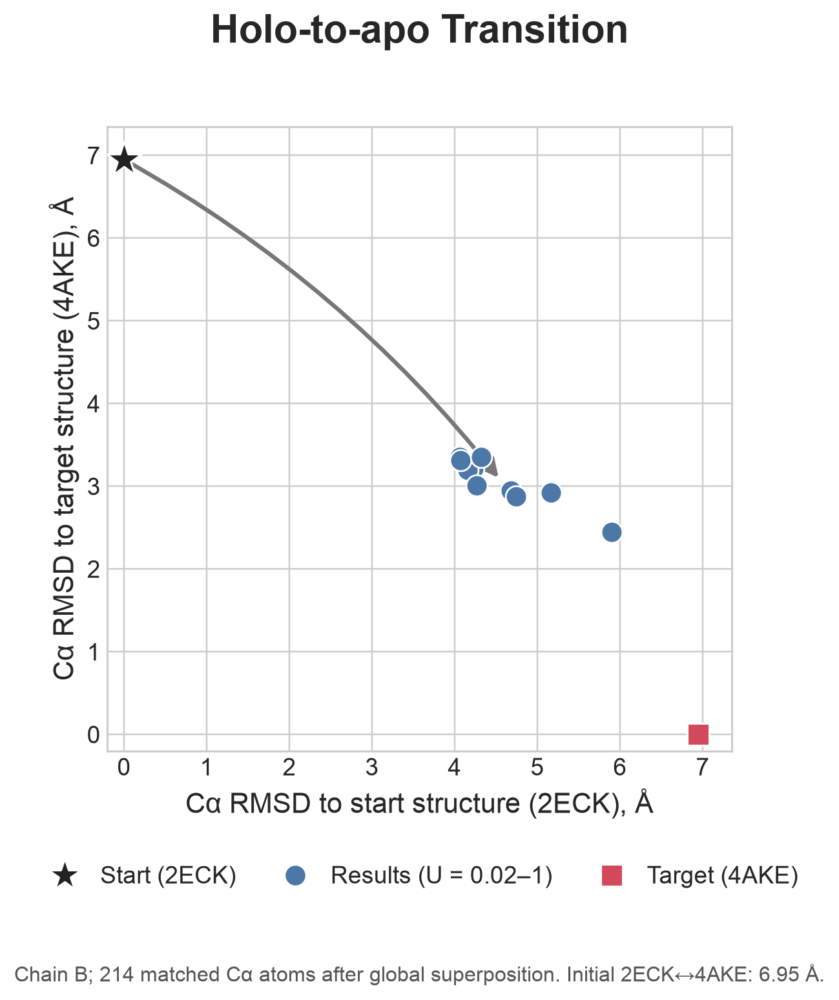

# Predicting the alternative conformation of a known protein structure based on the distogram of AlphaFold2

This repository extracts alternative residue-distance signals from
AlphaFold2 distograms and uses them as restraints for modeling alternative
protein conformations with PyRosetta.

The included example uses adenylate kinase (apo: 4AKE chain B; holo: 2ECK
chain B).

## Requirements

The workflow was tested in a Conda environment with the
following software versions:

| Software | Version |
| --- | --- |
| Python | 3.10.15 |
| PyRosetta | 2024.42+release.3366cf78a3 |
| NumPy | 2.1.3 |
| pandas | 2.2.3 |
| SciPy | 1.15.3 |
| gemmi | 0.7.5 |

Install PyRosetta according to the
[official download instructions](https://www.pyrosetta.org/downloads).
Install the remaining Python packages with your environment manager, for
example:

```bash
python -m pip install numpy==2.1.3 pandas==2.2.3 scipy==1.15.3 gemmi==0.7.5
```

Run all commands from the repository root so that the relative input and
output paths resolve correctly.

## Project layout

```text
AF2_DM/     AlphaFold2 prediction files
pdb/        Input protein structures
fasta/      Input sequence files
distfile/   Step 1 output files
data/       Scoring weights and modeling parameters
results/    Step 2 output models
docs/       Documentation figures
```

### Code organization

- `Step1-AlternativeSignalsAnalysis.py` contains reusable configuration and
  result data classes, distogram loading, signal analysis, and output writing.
- `Step2-Modeling.py` provides the typed modeling pipeline and automatically
  parallelizes independent Rosetta jobs.
- `arguments_AF2.py` defines the Step 2 command-line interface.
- `dij_magH_noroll_Utils_cycle_ros_dist_npy.py` contains Rosetta restraint
  generation and application utilities.

Both main scripts expose a `main()` function and can also be imported without
starting an analysis as a side effect.

## Step 1: Extract alternative signals

1. Place the AlphaFold2 prediction files in `AF2_DM/`. The included example
   was generated with
   [ColabFold](https://colab.research.google.com/github/sokrypton/ColabFold/blob/main/AlphaFold2.ipynb).
2. Place the known protein structure in `pdb/`. CIF format is recommended.
3. Run `Step1-AlternativeSignalsAnalysis.py` from the repository root:

```bash
python Step1-AlternativeSignalsAnalysis.py \
  2ECK B \
  AK_rec0_msaAll_27f14_all_rank_005_alphafold2_ptm_model_2_seed_000.pickle \
  0 0
```

Arguments:

1. PDB ID used to locate the input structure and name the output, for example
   `2ECK`.
2. Protein chain ID, for example `B`.
3. AlphaFold2 `.pickle` file containing the predicted distance map. The file
   must be located in `AF2_DM/`.
4. Optional: number of missing residues at the beginning of the structure
   relative to the prediction sequence. Defaults to `0`.
5. Optional: number of missing residues at the end of the structure relative
   to the prediction sequence. Defaults to `0`.

Run `python Step1-AlternativeSignalsAnalysis.py -h` for the built-in help.

The script writes the following files to `distfile/`:

| Output | Description |
| --- | --- |
| `alt-<PDB>alternative signals_*.csv` | Identified alternative residue pairs and signal statistics |
| `alt-<PDB>_altDM.npy` | Alternative distance map |
| `alt-<PDB>_flag.npy` | Residue-pair indices carrying alternative signals |
| `Comentropy_alt-<PDB>.npy` | Information content for the predicted distance map |
| `p-parameters.txt` | Signal parameters consumed by Step 2 |

## Step 2: Model alternative conformations

Step 2 requires the files produced by Step 1. Prepare a clean input PDB file
whose sequence matches the FASTA file; remove ligands or ions if they are not
part of the modeling system.

Run the example conversion from the holo state to the apo state:

```bash
python Step2-Modeling.py ./fasta/AK.fasta ./results/alt-2ECK_n
```

The first argument is the input FASTA file, and the second is the output PDB
filename prefix. Predicted models are written to `results/` using names such
as `alt-2ECK_n1_U0.02.pdb`. A representative set of sampled models is included
in the repository.

Independent `(ncycle, U)` combinations run in parallel by default. The
automatic worker count is limited by available CPUs, available memory
(approximately 2 GiB per worker), and the number of requested models. Set
`-j 1` to disable parallelism or `-j N` to select a fixed worker count.

Useful options:

```text
-pd FLOAT          Minimum distance-restraint probability
-m {0,1,2}         Restraint-application schedule
-w PATH            Directory for temporary files
-n INT             Number of minimization steps
-j, --jobs INT     Parallel worker processes; 0 selects automatically
--seed INT         Base random seed; each model receives a derived seed
--ncycles LIST     Comma-separated ncycle values instead of the default sweep
--u-values LIST    Comma-separated U values instead of the default sweep
--orient           Enable orientation restraints
--no-orient        Disable orientation restraints
--fastrelax        Enable FastRelax refinement (default)
--no-fastrelax     Disable FastRelax refinement
```

Run `python Step2-Modeling.py -h` for the complete command-line reference.
Modeling parameters and Rosetta scoring weights are stored in `data/`.

## Structural transition



The figure summarizes the structural transition from the included holo
structure (2ECK) to the target apo structure (4AKE). Each circle represents
one model in `results/`; the arrow connects the initial 2ECK structure to the
mean of the result models.

The metrics use all 214 matched chain-B Cα atoms after global superposition.
For reference, the initial 2ECK-to-4AKE comparison gives a Cα RMSD of 6.95 Å.

For details about the modeling process, refer to the "Materials and Methods:
Model Building and Assessment" section of the associated paper.

## Author

Jiaxuan Li
